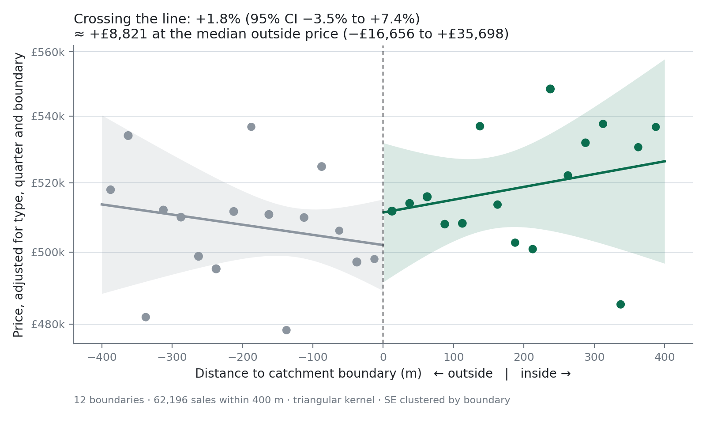

# What a London catchment line is worth

[](https://github.com/FireCloud24/london-catchment-line/actions/workflows/tests.yml)

I measured what a secondary school's catchment boundary adds to London house prices, by
comparing homes a few metres either side of the line.

## Why I cared

In London, a good school catchment is talked about as if it came with a price tag, and the
numbers people quote are large. Most of those numbers compare whole neighbourhoods, so they
also measure everything else that differs between them. I wanted to know what the line itself
is worth when the houses on both sides share the same streets.

## What I found

Across twelve oversubscribed London secondaries, a home just inside the admissions line sold
for about **+1.8%** more than one just outside: **+£8,821** at the median outside price of
£480,000. The 95% interval runs from −3.5% to +7.4% (−£16,656 to +£35,698), so I can't tell
the premium apart from zero. Large premiums are ruled out. A small one is possible, but this
study doesn't establish it.



*Each dot is a 25 m band of sales. The lines are local linear fits on each side of the
boundary, with 95% bands.*

My working title was "The £54,000 Line". I left the number blank until the pre-registered
analysis produced one. The full write-up, with every check, is at
**[firecloud24.github.io/london-catchment-line](https://firecloud24.github.io/london-catchment-line/)**.

## Why not just regress price on school quality

That analysis almost always finds a big premium, and it is almost always measuring something
else. Good schools sit where families with money already live, and those families pay for
gardens, quiet streets and shops as well as schools. Controls only remove what someone thought
to measure.

So there were two ways to read the premium people quote: the school, or the neighbourhood that
comes with it. Comparing sales a few metres either side of a boundary takes the neighbourhood
away. Those houses share streets, bus stops and postcode sectors. Only admission eligibility
changes.

## How I tested it

- **Plan first.** I committed the selection rules and the analysis plan in
  [`PREREGISTRATION.md`](PREREGISTRATION.md) before downloading any data. Every later change
  is dated in [`DEVIATIONS.md`](DEVIATIONS.md), with whether I had seen prices at the time.
- **Boundaries.** Councils don't publish catchment boundaries, so I rebuilt them from each
  council's "last distance offered" figures, only for schools that admit on straight-line
  distance. For those schools the line is a circle and the rule is mechanical.
- **Schools.** Of 914 London secondary school records, 88 passed the type, faith and quality
  rules, and twelve passed the rest. I re-checked 80 cut-off figures against their sources
  ([`VERIFY.md`](VERIFY.md)), then locked the set before examining a single price. The lock is
  commit `e02187a`; `DEVIATIONS.md` explains why that hash changed.
- **Estimate.** 62,196 sales from 2015 to 2025 within 400 m of the twelve lines, with a
  straight-line fit on each side and allowances for property type, quarter and boundary.
  Distances are in British National Grid metres, and code that receives degrees raises an error.
- **Uncertainty.** Twelve boundaries are too few for ordinary clustered p-values, so I also
  report a wild cluster bootstrap. Clustered p = 0.47, bootstrap p = 0.66.

## Trying to break it

I ran every pre-registered check, including the ones that came out awkwardly. Most hold. Fake
lines 250 and 500 m either side of the real one show nothing. Sales don't bunch just inside
the line (McCrary test p = 0.46). Dropping sales within 25 or 50 m of the line leaves the
estimate in place.

Three don't hold:

- Inside the line there are 5.2 percentage points fewer flats (p = 0.03), so the two sides are
  not quite alike.
- Measuring each sale against the cut-off published just before it, instead of the median,
  gives −2.3% (p = 0.05).
- One school carries much of the positive estimate. Coombe Girls' School in New Malden shows
  +27.8% on its own. Without it, the pooled estimate is −0.4% (−2.6% to +1.8%).

## What surprised me

Coombe Girls'. Its northern arc passes Coombe Hill, one of London's most expensive enclaves,
where prices change by hundreds of thousands of pounds within a few streets for reasons that
have nothing to do with a school. None of my pre-registered balance checks could see that.
Comparing sales only within the same 45° arc of each circle cuts Coombe's jump to +11.1% and
moves the pooled estimate to +2.9% (+0.3% to +5.7%). I wrote that analysis after seeing the
results, so it stays exploratory, and the pre-registered number stays the headline.

I think my estimate is nearer a floor than a ceiling, because two known problems push it
toward zero. Sale locations are postcode centroids of about
fifteen addresses, so some sales near every line sit on the wrong side of it (3.3% of the
sample lies within 25 m). And several schools measure to a named gate, while I drew circles
from the school's registered coordinate. Both blur the line and flatten a jump.

## What went wrong along the way

- I caught two wrong Ofsted records, one duplicated council table and one wrong search
  summary in the sources. Each is documented in the code or in `VERIFY.md`.
- Ofsted grades were harder than they looked. The grade in force has to follow a school
  across academy conversions, and through the end of single-word judgements in September 2024
  and the report cards of November 2025.
- I later rewrote commit messages, which changed every recorded commit hash. The lock was
  originally `f123bcc`. `DEVIATIONS.md` (2026-11-12) maps old hashes to new.

## Limits

- Twelve schools that admit on distance, are rated above their neighbours and are mostly in
  outer boroughs. Banded, faith and selective schools, common in inner London, are excluded
  by design.
- It prices eligibility for a school parents rate, not the quality of its teaching, and it
  follows no pupil.
- Being inside the line raises the odds of a place. Siblings and moving cut-offs mean it does
  not secure one.

## Run it

Python 3.12, from the repository root:

```
pip install -r requirements.txt
python -m unittest discover -s tests -t .     # 45 tests, synthetic data only
python -m pipeline.run                        # downloads (~2.4 GB) through to the writeup
```

`pipeline.run` stops at phase 06 until `catchments/selection_lock.json` exists, on purpose
(pre-registration section 9). After verifying the boundaries:

```
python -m pipeline.lock_selection --verified-by "Your Name"
python -m pipeline.run --from 06
```

Each of the ten phases in `pipeline/` writes its output to disk, so nothing depends on notebook
state. Phase 07 writes `outputs/results/main.json`, phase 08 the table of checks and phase 10
the write-up in `docs/index.html`.

```
PREREGISTRATION.md   selection rules and analysis plan, committed first
DEVIATIONS.md        every change to the plan, dated
VERIFY.md            how the catchment research was checked before locking
docs/                the write-up (served by GitHub Pages)
catchments/          provenance.csv (cut-offs by school and year), research_log.csv (all 88 candidates)
line54/              geometry, RD estimator, density test, grades, robustness, figures
pipeline/            one script per phase
tests/               unittest suite on synthetic data with a planted discontinuity
outputs/             tables, figures, results (data/ is not committed)
```

## Licences

The code and the writing are released under the MIT licence ([`LICENSE`](LICENSE)). Data and
derived outputs keep their original licences:

- Contains HM Land Registry data © Crown copyright and database right 2021.
  This data is licensed under the Open Government Licence v3.0.
- ONS Postcode Directory (August 2026): Source: Office for National Statistics
  licensed under the Open Government Licence v3.0. Contains OS data © Crown
  copyright and database right. Contains Royal Mail data © Royal Mail copyright
  and database right.
- Get Information About Schools, Ofsted management information and NaPTAN:
  Open Government Licence v3.0.
- Council admissions documents are cited row by row in
  `catchments/provenance.csv`.
